# A Whole-Image YOLOv10n Pipeline for Cytosolic Microtubule Candidate Detection and Browser-Based Review

Ooi Kai Hong · [ORCID 0000-0003-3803-7864](https://orcid.org/0000-0003-3803-7864)  
Repository technical report · 3 November 2026  
Status: development evaluation; not a peer-reviewed publication


[Software citation](citation.cff) · [Deployment guide](microtubule-studio/DEPLOYMENT.md) · [Machine-readable results](microtubule-studio/metrics/) · [Figure data](docs/outputs/)

This README is the technical report for the selected GitHub upload package. The release contains `refined1024.onnx`; the later experimental cell-segmentation package is separate. Results below describe recorded development evaluations. No independent test evaluation is available.

| Selected pipeline result | Value | Evaluation population |
| --- | ---: | --- |
| Count MAE | 3.0667 microtubules/cell | 135 reference-resolved cells |
| Count RMSE | 5.3236 microtubules/cell | Same 135 cells |
| Mean signed count error | −2.2667 microtubules/cell | Same 135 cells |
| Cytosolic precision | 55.90% | 25 development images, confidence ≥0.174 |
| Cytosolic recall | 53.86% | 1,970 annotated cytosolic objects |
| Cytosolic F1 | 54.86% | One-to-one box matching at IoU ≥0.5 |
| Low-contrast annotated-object recall | 54.50% | Contrast-defined annotated subgroup |
| Selected-pipeline cytosolic AP50 | 0.4463 | Precision–recall integration across scores |
| Restricted annotated-object ROC-AUC | 0.8568 | 1,970 cytosolic regions; 198 centrosomal controls |

The browser shows image-level candidate totals. The per-cell results require supplied reference cell polygons. Restricted ROC-AUC does not estimate specificity across image background.

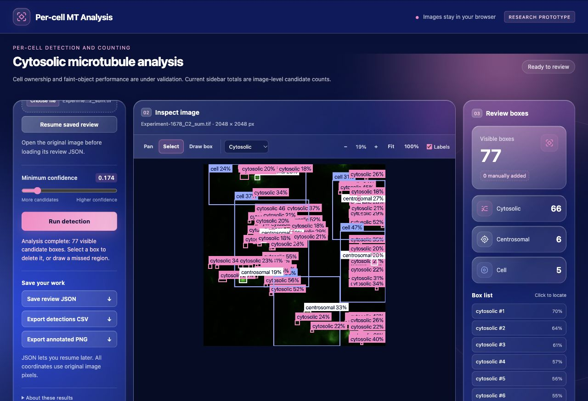

Figure 1. Recorded browser view of `Experiment-1678_C2_sum.tif` at confidence 0.174: 66 cytosolic candidates and 6 centrosomal candidates, plus 5 cell rectangles. The 77 visible boxes are candidates across all classes, not a per-cell microtubule count. The screenshot predates this documentation revision.

## Abstract

Fluorescence microscopy images contain cytosolic microtubule annotations with variable contrast and uncertain cell ownership. This project evaluates available YOLOv10n checkpoints for candidate detection and per-cell counting, then deploys one selected model in a browser reviewer. The supplied dataset contains 105 images at 2048 × 2048 pixels, with 80 training sources and 25 development sources. Ten inference policies were compared using four full-label checkpoints, including 1024 + 2048 ensembles. Confidence cutoffs were determined on 20 training-side sources. Selection used count mean absolute error (MAE) across 135 development cells with resolved reference ownership. Refined YOLOv10n at 1024 pixels, with overlap suppression above intersection-over-union (IoU) 0.5 and confidence ≥0.174, achieved MAE 3.0667 and root mean squared error (RMSE) 5.3236 microtubules per cell. Mean signed error was −2.2667. Cytosolic precision was 0.5590 and recall was 0.5386; F1 was 0.5486. Low-contrast annotated-object recall was 0.5450. Restricted annotated-object ROC-AUC was 0.8568, using cytosolic annotations as positives and centrosomal annotations as controls. This AUC does not establish field-wide specificity. ONNX Runtime CPU checks and JavaScript coordinate checks covered all 25 development sources. The browser displays image-level candidates and supports manual corrections. Reuse of development images and incomplete reference labels constrain interpretation; no independent test result is available.

## 1. Task and scope

The target is the annotation unit labelled `cytosolic`: an axis-aligned bounding box around a cytosolic microtubule candidate. Detection is distinct from measuring filament length or reconstructing an entire microtubule network. The pipeline also predicts centrosomal objects and cells, but its deployment selection criterion is cytosolic count error within supplied cell polygons.

YOLOv10 introduces consistent dual assignments for end-to-end detection [1]. This project uses its nano variant through Ultralytics. The release adds a score-ordered overlap filter because that policy performed better for the current count objective. The filter is part of this operational pipeline; the underlying model's end-to-end design does not establish that postprocessing is optimal for this dataset.

The current browser application is a candidate reviewer. Its image-level totals must not be read as the offline per-cell results. Cell polygons supplied with the annotations define the evaluation regions; the browser's predicted cell rectangles have not been validated as a replacement.

## 2. Dataset and reference audit

### 2.1 Images and classes

The supplied sources are single-page, 2048 × 2048, 8-bit palette TIFFs. The palette maps intensity to green RGB values. Decoding these TIFFs does not recover raw photon counts or higher-bit-depth acquisition data. The audited native-resolution preparation converts each source to RGB PNG and verifies pixel equality against the decoded TIFF palette.

| Partition | Sources | Cytosolic boxes | Centrosomal boxes | Cell boxes | All boxes |
| --- | ---: | ---: | ---: | ---: | ---: |
| Training | 80 | 1,484 | 290 | 258 | 2,032 |
| Development, stored as `val` | 25 | 1,970 | 198 | 166 | 2,334 |
| Total | 105 | 3,454 | 488 | 424 | 4,366 |

The audited class mapping is fixed: 0 = cytosolic, 1 = centrosomal, 2 = cell. The preparation audit matched all 4,366 YOLO boxes to their LabelMe class and bounding extent. Four boundary extents were clipped; the recorded excursions were extremely small floating-point negatives. No exact duplicate decoded RGB images were found. This check does not establish independence between acquisitions.

The historical conversion notebook used an unordered set for class assignment, and historical YAML names were inconsistent. Current preparation checks the source shapes and applies the explicit mapping above. The exported graph also receives explicit class names. The original conversion notebook remains in the local research workspace; it is not bundled in this release.

Dataset provenance beyond the supplied source files is incomplete. This release does not infer microscope settings or biological treatment groups. It does not attach a physical pixel spacing that was not verified from the evaluated files.

Sources: [dataset audit](microtubule-studio/metrics/dataset_audit_summary.json), [source manifest](microtubule-studio/metrics/image_manifest.csv).

### 2.2 Development exposure

The 25 development images had already been used during model development. They were also used to select the final deployment policy. They are not an untouched test set.

An audit splits the 80 training-side sources into 60 likelihood-fit sources and 20 calibration sources with NumPy seed 42. That separation controls the exploratory likelihood fitting and cutoff calculation, but the detector itself had seen the training-side images. The calibration results therefore do not establish generalization to unseen images. No experiment-level grouping metadata was supplied to verify separation by acquisition or biological replicate.

### 2.3 Conservative cell ownership

Each supplied cell polygon is rasterized. An object receives a reliable owner only when its box centre is inside exactly one polygon and that polygon contains at least 80% of the rasterized box. Coverage by the second polygon must be at most 10%, and the winning polygon must pass the geometry checks. The implementation rejects self-crossing geometry under its tested segment rule and polygons with fewer than 100 raster pixels. It does not assign an object to the nearest cell when these rules fail.

Across 3,454 cytosolic annotations, 3,117 receive reliable assignments; 277 are unowned and 60 are ambiguous. One cell polygon fails the geometry audit. Development annotations comprise 1,794 reliably assigned objects, 146 unowned objects and 30 ambiguous objects. All supplied cytosolic positives remain in object-level evaluation, regardless of ownership.

A reference-resolved cell has valid geometry and no ambiguous reference object that could belong to it. There are 135 such cells among the 166 development cell polygons. Prediction counts include only reliably owned cytosolic detections within this fixed cohort. These cells contain 1,265 reliably owned reference cytosolic objects. The cohort definition can exclude difficult boundaries, so its results do not describe every cell in the dataset.

Source: [ownership audit](microtubule-studio/metrics/ownership_audit_summary.json) and [`ownership_audit.py`](microtubule-studio/analysis/ownership_audit.py).

### 2.4 Contrast groups

Contrast is measured from the supplied 8-bit intensities. For an annotated box, let \(q_{90}\) be the 90th percentile inside it. Let \(m\) and MAD be the median and median absolute deviation of an eligible local ring:

$$
C=\frac{q_{90}-m}{\max(1,\;1.4826\,\mathrm{MAD})}.
$$

The ring excludes annotated objects plus a two-pixel margin. Where reliable ownership exists, the ring is restricted to the owning cell. At least 32 background pixels are required. Ring padding follows the audited box-size rule in the source code.

The 60 likelihood-fit sources determine tertile cutpoints: 2.84785 and 4.72144. Low contrast means \(C\le2.84785\). The cutpoints are then applied to development annotations without refitting. Missing contrast values remain a separate category. The term faint in the released metrics refers to this low-contrast annotation group; it is not a verified catalogue of every faint biological object in the image.

## 3. Model and training records

### 3.1 Detector representation

The network is YOLOv10n with a three-class detection head. It uses the YOLOv10 convolutional detector architecture and its multi-scale detection features [1,2]. The task is bounding-box detection. Cell polygons are converted to rectangles for detector training, so the model is not a cell-segmentation network.

The exported release has fixed float32 input `[1, 3, 1024, 1024]` in RGB channel-first order. Its output is `[1, 300, 6]`, with rows containing \((x_1,y_1,x_2,y_2,s,c)\). The graph returns at most 300 rows across all classes. Dense fields can be limited by this shared cap. The release does not claim a measured parameter count or inference speed because those measurements are absent from the supplied selection reports.

### 3.2 Selected 1024 checkpoint

The saved configuration names `yolov10n.pt` as the starting model. Although the experiment is named refined, the saved arguments do not document initialization from the earlier 640 checkpoint. The recorded settings must be used when interpreting that name.

| Recorded setting | Value |
| --- | --- |
| Input size | 1024 × 1024 |
| Requested / logged epochs | 80 / 80 |
| Batch size | 2 |
| Device argument | CUDA device `0` |
| Optimizer argument | `auto`; the configuration alone does not identify its resolved choice |
| Seed / deterministic | 0 / true |
| Patience | 20 |
| Initial LR argument / final LR fraction | 0.01 / 0.01 |
| Momentum / weight decay arguments | 0.937 / 0.0005 |
| Warmup epochs | 3 |
| Box / classification loss weights | 7.5 / 0.5 |
| Distribution focal loss weight | 1.5 |
| Horizontal / vertical flip probability | 0.5 / 0.0 |
| Translation / scale augmentation arguments | 0.1 / 0.5 |
| Mosaic probability / final closed epochs | 1.0 / 10 |
| HSV hue / saturation arguments | 0.015 / 0.7 |
| HSV value argument | 0.4 |
| Mixup | 0.0 |
| AMP | true |

These are saved arguments, not a reconstruction of undocumented runtime decisions. The complete [configuration](microtubule-studio/metrics/refined1024-args.yaml) contains the other options. Training used the established source split. It did not reserve the 25 development images as an independent final test.

The [training CSV](microtubule-studio/metrics/refined1024-training.csv) contains 80 completed epochs. Its largest logged all-class mAP50–95 is 0.26342 at epoch 61; the corresponding mAP50 is 0.55627. The final epoch records mAP50–95 0.24243 and mAP50 0.53864. Training loss values at epoch 80 are 1.87932 for box loss, 2.36540 for classification loss and 1.20997 for distribution focal loss. These losses measure different objectives and must not be compared as percentages or treated as detection accuracy.

The released checkpoint is identified by SHA-256 below. The paper does not equate a logged epoch row with a later standalone validator result: preprocessing and checkpoint handling can differ.


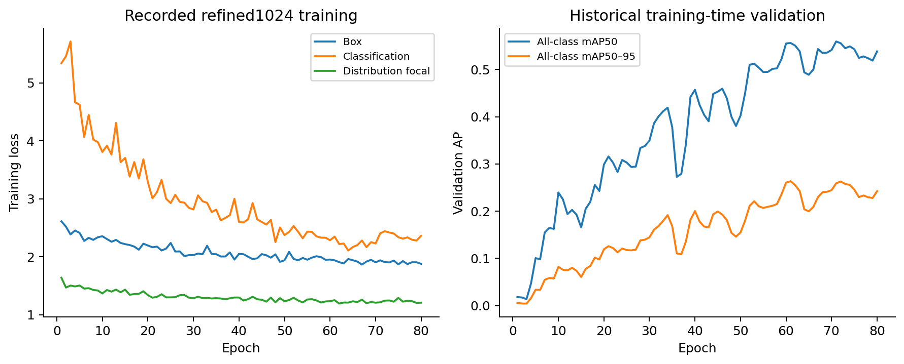

Figure 2. Selected-model training history reconstructed from the saved CSV. The AP curves summarize all classes during historical validation; they are separate from the selected cytosolic deployment metrics.

<details>
<summary>Full training dashboard and historical class curves</summary>

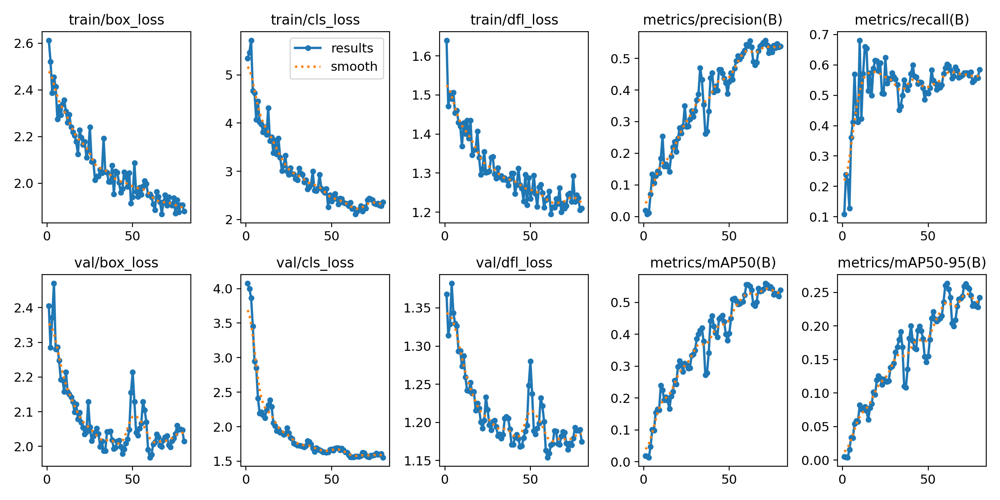

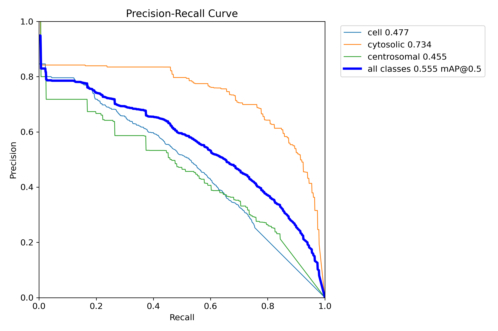

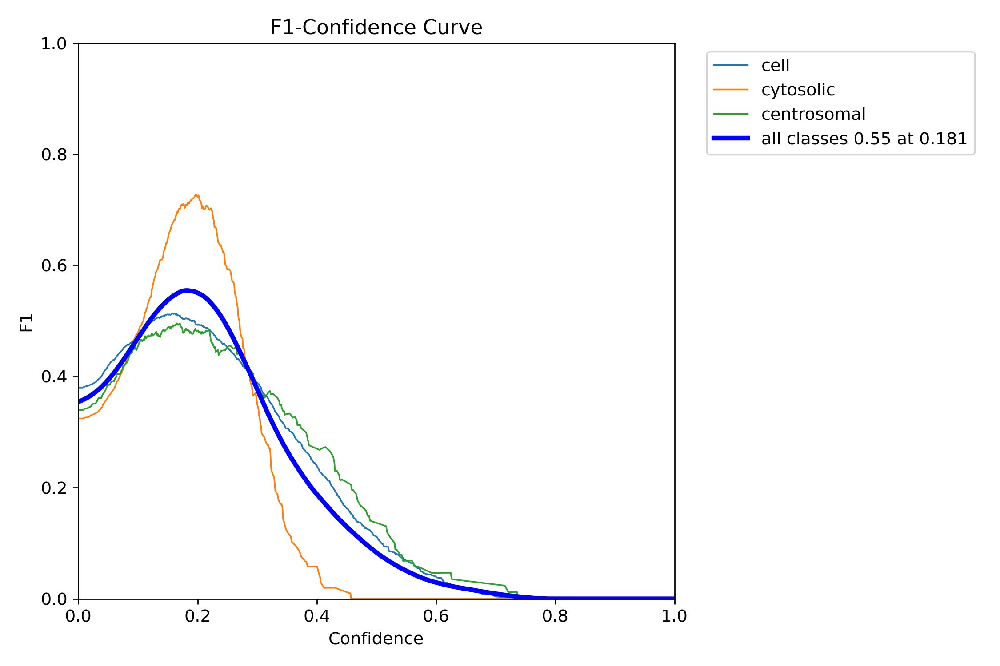

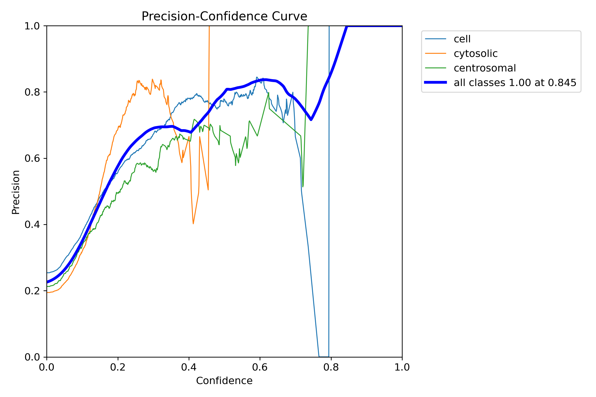

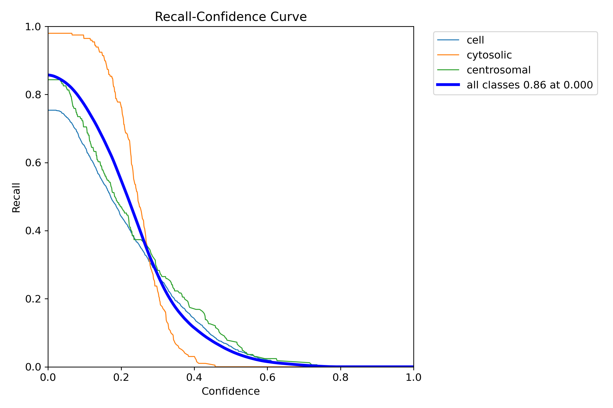

These are saved training-validator outputs. Their confidence optima do not define the release cutoff, which follows the count-calibration rule in Section 4.

</details>

### 3.3 Other available full-label candidates

The baseline used 640-pixel input with 50 requested epochs and batch 16 in its saved arguments. The native 2048 run completed 80 epochs at batch 1 on CPU. Its training status records an optimizer-state reset during continuation. It disabled mosaic and scale augmentation; horizontal and vertical flips were retained.

The 2048 fine-tuning experiment started from the selected refined checkpoint. Its recorded plan used AdamW at learning rate 0.0001, batch 1 and patience 10, with seed 42. Its workflow records completion after 26 epochs. These checkpoints have different training histories; the comparison is a practical choice among available candidates, not a controlled experiment isolating input resolution.

An omission-training experiment existed for annotation-quality research. It was excluded from this deployment comparison because the intended detector retains all original positives. No reviewed new cytosolic label was verified by the limited missing-label screen; the release does not claim an annotation-correction gain.

## 4. Native comparison and selection

Four native PyTorch checkpoints were run on the same 20 calibration sources and 25 development sources at their respective input sizes. The proposal confidence floor was 0.001 and the maximum output count was 300 across classes. The prediction call used `iou=0.7`; the additional cytosolic suppression step described below is a separate operation.

Each checkpoint was evaluated alone and with cytosolic overlap suppression, producing eight policies. Two further policies combined refined1024 with one of the 2048 checkpoints. An ensemble unions cytosolic candidates in original-image coordinates and applies score-ordered suppression at IoU >0.5. It retains the winning member's box and score; it does not average coordinates or learn a fusion model. Equal-score ties use stable ordering. Scores from different members are not separately calibrated probabilities.

For every policy, calibration permits at most \(\lfloor0.1N_{\rm cal}\rfloor\) unmatched, reliably owned predictions over all annotated calibration cells. Predictions are matched to reference objects at IoU ≥0.5. The cutoff is the smallest three-decimal value strictly above the first disallowed unmatched score, with a minimum of 0.05. Unmatched annotations can reflect incomplete reference labels, so the budget is not a verified biological false-positive rate.

Policies are ranked by per-cell MAE; RMSE breaks ties. The following table is taken from [comparison.csv](microtubule-studio/metrics/comparison.csv). Every row uses the same 135 reference-resolved development cells.

| Policy | Cutoff | MAE | RMSE | Signed bias | Low-contrast recall |
| --- | ---: | ---: | ---: | ---: | ---: |
| refined1024_nms | 0.174 | 3.0667 | 5.3236 | −2.2667 | 54.50% |
| refined1024_plus_native2048 | 0.245 | 4.1630 | 6.8982 | −3.8667 | 43.17% |
| baseline640_nms | 0.135 | 4.2000 | 6.8557 | −3.9333 | 36.80% |
| baseline640 | 0.156 | 4.3259 | 7.0826 | −3.6444 | 32.92% |
| refined1024 | 0.256 | 4.4074 | 7.4511 | −4.1556 | 35.56% |
| refined1024_plus_fine_tuned2048 | 0.287 | 5.0370 | 7.8834 | −4.8444 | 33.70% |
| fine_tuned2048 | 0.214 | 6.5111 | 9.8631 | −6.4519 | 18.01% |
| fine_tuned2048_nms | 0.214 | 6.8519 | 10.1204 | −6.8074 | 17.86% |
| native2048_nms | 0.189 | 6.9407 | 10.3025 | −6.8815 | 24.07% |
| native2048 | 0.285 | 7.8148 | 11.3767 | −7.7556 | 12.89% |

The selected pipeline has the smallest count MAE under this calibration rule. The best ensemble has higher AP50, 0.4737, but worse count MAE, 4.1630. Selection therefore follows the declared count objective. A change of objective or calibration policy could change the preferred method.


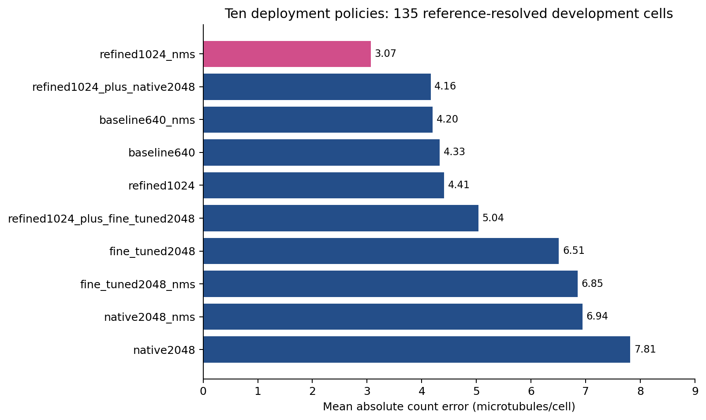

Figure 3. Count MAE on the same 135 reference-resolved development cells. Each policy uses its own calibrated confidence cutoff. The comparison changes both model policy and operating point.

The companion table reports object-level results for every policy. Precision, recall and F1 apply at each row's cutoff. AP50 and restricted AUC summarize scores across thresholds.

| Policy | Precision | Recall | F1 | Cytosolic AP50 | Restricted ROC-AUC |
| --- | ---: | ---: | ---: | ---: | ---: |
| refined1024_nms | 0.5590 | 0.5386 | 0.5486 | 0.4463 | 0.8568 |
| refined1024_plus_native2048 | 0.6080 | 0.4416 | 0.5116 | 0.4737 | 0.8781 |
| baseline640_nms | 0.4885 | 0.3675 | 0.4195 | 0.3119 | 0.7856 |
| baseline640 | 0.4363 | 0.3335 | 0.3780 | 0.2912 | 0.8070 |
| refined1024 | 0.5558 | 0.3792 | 0.4508 | 0.4106 | 0.8724 |
| refined1024_plus_fine_tuned2048 | 0.6168 | 0.3660 | 0.4594 | 0.4640 | 0.8810 |
| fine_tuned2048 | 0.5217 | 0.2015 | 0.2907 | 0.3007 | 0.8201 |
| fine_tuned2048_nms | 0.5904 | 0.2005 | 0.2994 | 0.3577 | 0.8073 |
| native2048_nms | 0.6505 | 0.2173 | 0.3257 | 0.3922 | 0.8099 |
| native2048 | 0.5697 | 0.1183 | 0.1959 | 0.2999 | 0.8200 |

Full-precision results, including matching totals and unmatched-owned rates, are in [comparison.csv](microtubule-studio/metrics/comparison.csv).

## 5. Metrics and their interpretation

### 5.1 Per-cell count errors

For each of the \(n=135\) cells, let \(y_i\) be the reliably owned reference count and \(\hat y_i\) the reliably owned prediction count. Define \(e_i=\hat y_i-y_i\):

$$
\operatorname{MAE}=\frac{1}{n}\sum_i|e_i|,\qquad
\operatorname{RMSE}=\sqrt{\frac{1}{n}\sum_i e_i^2},\qquad
\operatorname{bias}=\frac{1}{n}\sum_i e_i.
$$

The selected row has \(\sum|e_i|=414\), \(\sum e_i^2=3826\) and \(\sum e_i=-306\). Thus:

$$
\operatorname{MAE}=414/135=3.0667,
\quad\operatorname{RMSE}=\sqrt{3826/135}=5.3236,
\quad\operatorname{bias}=-306/135=-2.2667.
$$

MAE is the average magnitude of a cell's count error. RMSE gives larger errors more weight; its higher value indicates that some cells have substantially larger errors. Negative bias indicates undercounting on average. Cancellation can give a correct count even when specific boxes are wrong, so count errors must be interpreted alongside object matching.

| Additional count statistic | Recorded/derived result |
| --- | ---: |
| Reference / predicted total in resolved cells | 1,265 / 959 |
| Median absolute count error | 2 |
| Exact count | 19/135 cells, 14.07% |
| Absolute error ≤1 | 54/135 cells, 40.00% |
| Absolute error ≤5 | 120/135 cells, 88.89% |
| Maximum absolute count error | 33 |
| Source-bootstrap 95% MAE interval | 2.4471–3.7306 |
| Source-bootstrap 95% RMSE interval | 3.6878–6.8065 |

The descriptive intervals resample development sources as clusters and preserve cells within a sampled source. They do not account for selection among ten policies. The distributed interval JSON does not record its resampling seed or draw count; this paper does not assign unverified values to that calculation. Intervals describe this cohort, not an external population guarantee.

Sources: [per-cell records](microtubule-studio/metrics/per_cell_counts.csv), [count summary](microtubule-studio/metrics/count_summary.json), [intervals](microtubule-studio/metrics/source_bootstrap.json).

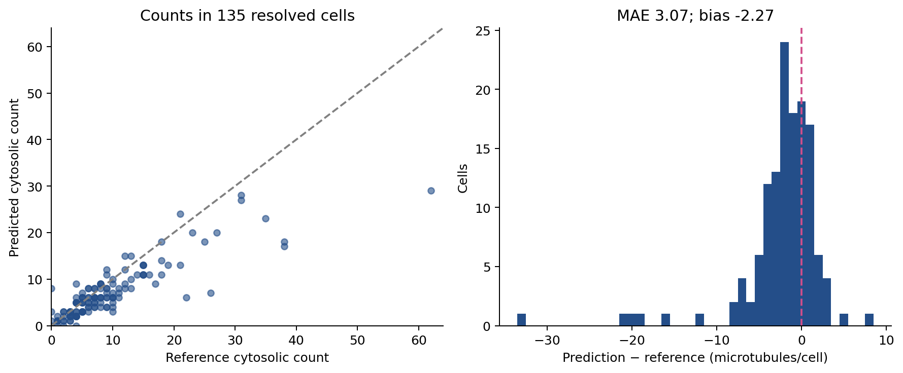

Figure 4. Cell-level count agreement and the signed error distribution at confidence 0.174. The identity line represents exact count agreement. Each point is one reference-resolved cell. [Download plotted cell records](docs/outputs/selected_per_cell_counts.csv).

### 5.2 Cytosolic object matching

Within each source, predictions are processed by descending confidence. A prediction matches one unused cytosolic reference box if IoU ≥0.5. Matching is one-to-one. At cutoff 0.174, the selected pipeline has 1,061 matches, 837 unmatched predictions and 909 missed annotations across the 25 development images:

$$
P=\frac{1061}{1061+837}=0.559009,
\qquad R=\frac{1061}{1061+909}=0.538579,
$$

$$
F_1=\frac{2(1061)}{2(1061)+837+909}=0.548604.
$$

Precision means the fraction of retained predictions matched to the supplied reference. Recall means the fraction of annotated objects matched by predictions. F1 balances those fractions. These object metrics include all 1,970 development cytosolic annotations; they use a different population from the 135-cell count cohort. Unmatched predictions are reference-unmatched candidates, not independently confirmed biological false positives.

Low-contrast annotated-object recall is 0.545031. This is conditional on objects that were annotated and had contrast measurements. It cannot estimate recall for faint objects absent from the reference.

### 5.3 AP50 and stock validator results

Selected-pipeline AP50 is 0.446255. The implementation computes the maximum precision at or above each recall level on a grid of 101 points from 0 to 1, then averages those values. It uses retained, overlap-suppressed cytosolic proposals across scores and IoU ≥0.5 matching. AP50 is a ranking summary; it is not the precision at confidence 0.174.

A separate stock validator record for the refined checkpoint at input 1024 reports the following. These numbers describe that validator's preprocessing and matching policy, not the custom deployment policy above.

| Class | Precision | Recall | AP50 | AP50–95 |
| --- | ---: | ---: | ---: | ---: |
| Cytosolic | 0.5374 | 0.4670 | 0.4727 | 0.1918 |
| Centrosomal | 0.6386 | 0.8030 | 0.7374 | 0.3738 |
| Cell | 0.4821 | 0.4992 | 0.4567 | 0.2126 |
| All-class summary | 0.5527 | 0.5897 | 0.5556 | 0.2594 |

AP50–95 averages AP over IoU thresholds from 0.50 through 0.95 in steps of 0.05 under the stock validator. Its stricter overlap requirements penalize imprecise localization. The lower cytosolic AP50–95 indicates limited performance under those stricter box criteria. The all-class summary must not be presented as cytosolic-only accuracy.

Source: [standalone validator record](microtubule-studio/metrics/refined1024-validator.json). The final training CSV and the standalone validator are separate records and should not be substituted for one another.

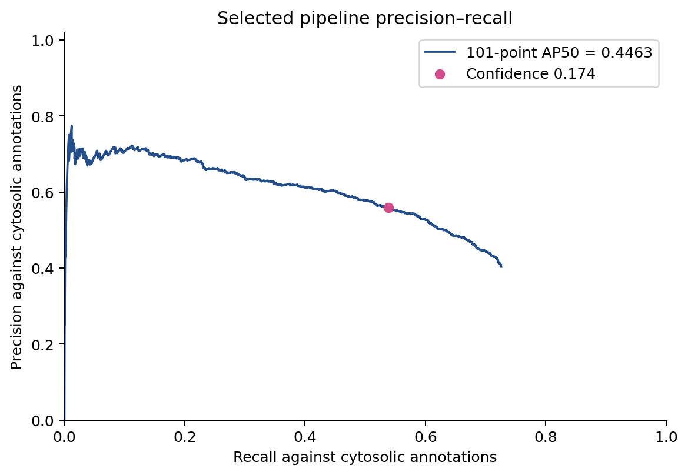

Figure 5. Cytosolic precision–recall curve after overlap suppression. The marker identifies confidence 0.174. This is the custom selected-pipeline curve, separate from the historical class curves in Figure 2. [Download curve coordinates](docs/outputs/selected_pr_curve.csv).

<details>
<summary>Historical stock-validator confusion matrices</summary>

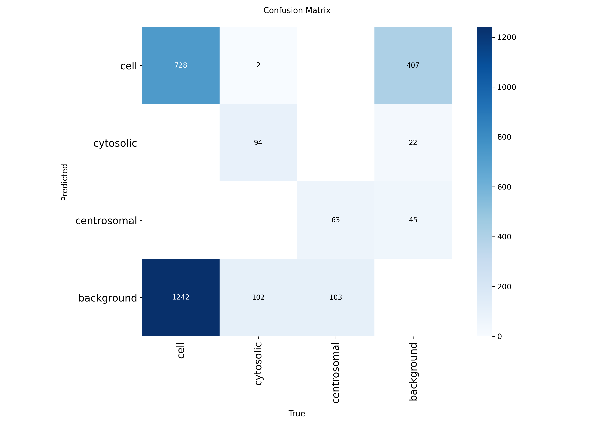

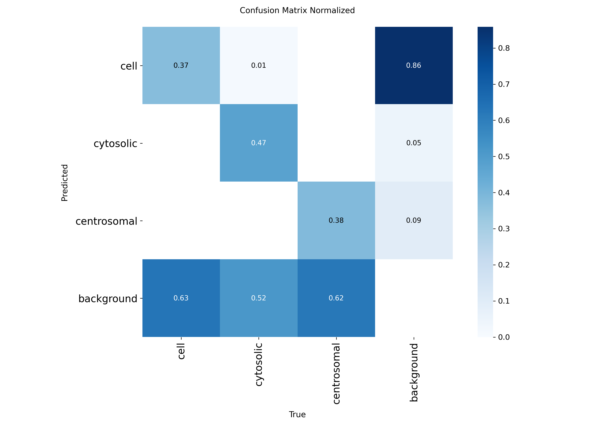

These matrices are saved validator artifacts. Their matching and threshold rules differ from the selected pipeline. They must not be used to derive the operating-point precision and recall reported in Section 5.2. The displayed background category does not supply verified true negatives for a field-wide specificity estimate.

</details>

### 5.4 Restricted ROC-AUC

The recorded ROC analysis defines 1,970 annotated cytosolic boxes as positives and 198 eligible annotated centrosomal boxes as controls. For each region, its score is the maximum cytosolic proposal score overlapping it at IoU ≥0.5, or zero when no proposal overlaps sufficiently. It uses proposals across retained scores, not only detections above the operating cutoff.

The rank-sum AUC is:

$$
\operatorname{AUC}=\frac{\sum_{j\in+}\operatorname{rank}(s_j)-n_+(n_++1)/2}{n_+n_-}=0.856786.
$$

Tied scores receive average ranks, equivalent to half credit in pairwise comparisons. The result measures whether a known cytosolic region ranks above a selected centrosomal control. It does not sample all background locations and is not a field-wide detector ROC-AUC. Verified background negatives were unavailable. Field-wide specificity and a biological false-positive rate are therefore not reported. A nominal threshold budget on training-side unmatched predictions does not supply those missing quantities.


Figure 6. ROC for annotated cytosolic regions against annotated centrosomal controls. Zero scores for regions without overlapping proposals contribute tied ranks. The curve does not include a representative sample of background regions. [Download curve coordinates](docs/outputs/restricted_roc_curve.csv) or [region scores](docs/outputs/restricted_roc_region_scores.csv).

### 5.5 Exploratory filament likelihood

The analysis code also contains a filament-versus-spot working likelihood. It fits a planar background plus a nonnegative oriented filament template, and compares it with a planar background plus an isotropic spot. Patches are 31 × 31 original pixels; borders use reflection padding. Shared shape parameters are fitted on training-side sources. The Gaussian residual variance has an explicit floor of \(1/12\) squared byte units.

The score is a difference of profiled log likelihoods. It is not a posterior probability. Spatial correlation and signal-dependent variance violate the simple physical-noise interpretation: the audit reports median lag-one correlation 0.4810 in diagnostic patches. No chi-square p-value or field-wide fixed-FPR improvement is claimed. This exploratory score is not part of the selected browser pipeline.

## 6. ONNX export and browser operation

### 6.1 Artifact identity

| Artifact property | Value |
| --- | --- |
| Selected native checkpoint SHA-256 | `8a4d977ad80a17bd5d61353154205fb2f2df045b40e00e60c77418292434d76f` |
| ONNX file | `microtubule-studio/dist/refined1024.onnx` |
| ONNX bytes | 9,565,211 |
| ONNX SHA-256 | `4f3f06f514a87daed9fc276bb1f7d678d044086661acabc278be00b0de0ea209` |
| Input / output | `[1,3,1024,1024]` / `[1,300,6]` |
| Export opset | 17 |
| Dynamic shapes / graph simplification | disabled / disabled |
| Browser confidence / suppression IoU | 0.174 / 0.5 |

The export script uses CPU float32 export. Only the selected model is distributed in the active app. The repository retains comparison results for other candidates without installing their binaries into the browser interface.

### 6.2 Preprocessing and coordinates

For the evaluated 2048-square sources, the app resizes the entire decoded RGB image to 1024 square and divides byte values by 255. The JavaScript half-size path reproduces the native uint8 rounding before normalization. A planar channel-first float32 tensor enters the network.

The reviewer also has a letterbox path for nonsquare inputs, with padding intensity 114. Box coordinates are unpadded, rescaled and clipped to the original image dimensions. Nonsquare-image accuracy and arbitrary TIFF encodings have not been established by the reported square-source parity checks.

The app retains valid class predictions with score ≥0.05, applies same-class suppression at IoU >0.5 and filters the visible set at the chosen confidence. The default is 0.174. Manual boxes have no model confidence and remain visible. Slider changes use cached predictions without another inference pass.

### 6.3 Review persistence

CSV exports visible box coordinates in original pixels. PNG exports are rendered at the original image size. Review JSON stores model provenance and correction state. Version 2 files include a SHA-256 fingerprint of the original image bytes. Import checks the fingerprint and image dimensions before restoring corrections; a visually identical re-encoded image remains a different file.

Corrections stay in browser memory until downloaded. HTTPS or localhost is required for image fingerprinting. The application loads ONNX Runtime Web 1.20.1 and UTIF.js 3.1.0 from jsDelivr. Inference uses WebAssembly with one configured thread. The implementation has no image-upload endpoint; network requests still occur for those dependencies and static assets.

### 6.4 Verification evidence and limits

ONNX Runtime CPU was compared with native PyTorch on all 25 development PNGs prepared from TIFF. Above score 0.05, detections were matched by class and box coordinates. The export check allows box differences of 0.5 pixels with relative tolerance \(10^{-4}\), and score differences of 0.002 with relative tolerance \(10^{-4}\). All 25 recorded checks passed.

The separate JavaScript parity record reports matching input tensors and original-coordinate cytosolic postprocessing on all 25 TIFF sources when paired with ONNX Runtime CPU. That record does not establish full WebAssembly parity on all 25 images.

An earlier local Safari integration check, documented in the deployment guide, decoded `Experiment-1678_C2_sum.tif` and ran the selected model through WebAssembly. It showed 66 cytosolic candidates, 6 centrosomal candidates and 5 cell boxes. Deletion and Undo were checked; a corrected review was restored with 65 cytosolic candidates. The fixture supplied model bytes and configuration directly, so the hosted model URL and download dialog were not verified by that fixture. The earlier results are reported as recorded checks, not newly repeated browser measurements for this documentation update.

The release validation command checks the model checksum and deployment configuration. The JavaScript test suite covers correction state and image identity; geometry and failure handling are also exercised. The test harness uses simulated DOM/canvas and inference objects. It does not replace deployment testing in a browser.

Sources: [export checks](microtubule-studio/metrics/export_verification.json), [JavaScript parity](microtubule-studio/metrics/javascript_parity.json), [deployment guide](microtubule-studio/DEPLOYMENT.md).

### 6.5 Example output and exported results

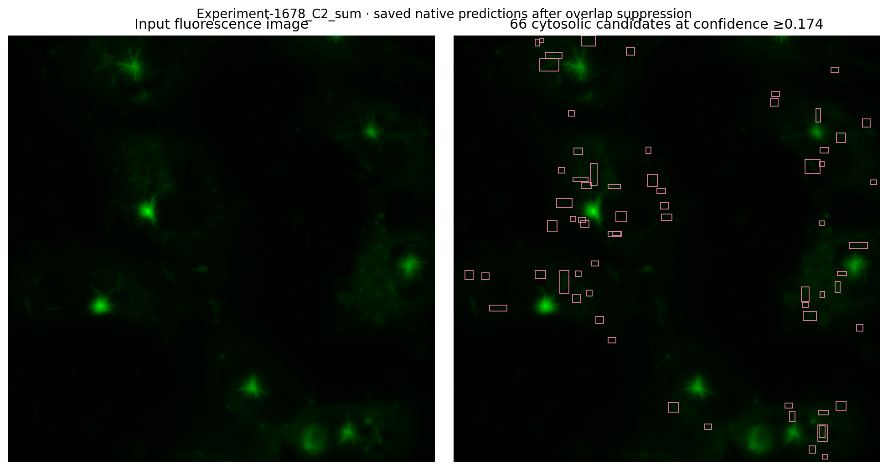

Figure 7. Input image and saved native predictions for `Experiment-1678_C2_sum`, after selected-pipeline suppression and confidence filtering. The overlay contains 66 cytosolic candidates and reproduces the cytosolic total in Figure 1. This single example does not estimate dataset performance. [Download the example detection CSV](docs/outputs/Experiment-1678_C2_sum_cytosolic.csv).

| Output | Contents | Scope |
| --- | --- | --- |
| Detection CSV | Class and box coordinates in original pixels | Visible reviewed candidates |
| Annotated PNG | Image with visible detection boxes | Original image dimensions |
| Review JSON | Correction state and model provenance, with image fingerprint | Resume review with the original file |
| Per-cell evaluation CSV | Reference/predicted counts and signed errors | Offline reference-polygon cohort |

The saved figure data were recomputed from cached predictions without a new inference run. [figure_provenance.json](docs/outputs/figure_provenance.json) records the input hashes. The export format in the browser can differ from the native example CSV; neither automatically supplies validated cell ownership.

## 7. Reproducibility and availability

The repository provides the selected ONNX artifact and inference source. It includes the evaluation scripts, plus recorded metrics in machine-readable form. The raw TIFFs and LabelMe files are not bundled. Native training checkpoints are also absent. Their omission prevents a fresh training reproduction or full native comparison from this repository alone.

To check the supplied browser release from the repository root:

```bash
node microtubule-studio/scripts/check-deployment.cjs
node --test microtubule-studio/tests/*.test.cjs
python3 -m http.server 8765 --bind 127.0.0.1 --directory microtubule-studio/dist
```

The original workspace layout places `channel2_input2/`, `yolo_dataset/` and `results/` beside `microtubule-studio/`. Given those research files and the native checkpoints, the following commands describe the source workflow:

```bash
cd microtubule-studio
python3 analysis/ownership_audit.py --root .. --output analysis_runs/per_cell_v1
python3 analysis/select_native_detector.py
python3 training/export_browser.py \
  --weights ../results/runs/detect/runs/yolov10n_refined/weights/best.pt \
  --size 1024 --output evaluation/native_selection/browser --all-validation
```

The native preparation workflow is available in `training/prepare_native.py`. The saved selected-model arguments describe its original 1024 training; `training/train.py` has additional controls for the later native-resolution experiments and should not be treated as an identical replay of that original run. Some experiment wrappers contain original-workspace paths and require the documented layout or path updates.

Recorded local analysis dependencies included Ultralytics 8.4.9 and PyTorch 2.11.0. The scripts also require NumPy and pandas, with SciPy and OpenCV for matching/audits. Pillow and PyYAML support preparation. ONNX export requires ONNX Runtime and ONNX. A complete frozen environment for the original 1024 training was not supplied.

| Evidence file, under `microtubule-studio/metrics/` | Purpose |
| --- | --- |
| `selected.json` | Selected pipeline metrics without display rounding |
| `comparison.csv` | All ten policies and their metric values |
| `design.json` | Selection rule and native checkpoint hashes |
| `per_cell_counts.csv` | Reference/predicted cell counts for each policy |
| `count_summary.json` | Additional selected-count summaries |
| `source_bootstrap.json` | Recorded source-cluster intervals |
| `refined1024-training.csv` | Per-epoch losses and validation metrics |
| `refined1024-args.yaml` | Saved training arguments |
| `refined1024-validator.json` | Separate stock validator metrics by class |
| `dataset_audit_summary.json` | Source dimensions and class counts |
| `ownership_audit_summary.json` | Ownership rules and contrast cutpoints |
| `image_manifest.csv` | Source split assignments |
| `export_verification.json` | Native-to-ONNX checks on 25 sources |
| `javascript_parity.json` | JavaScript input/coordinate parity records |

The previous repository main at commit `f5a23adc00df8519615a1cddd2208e668355aa5e` is preserved as a complete Git tree under [`archive/legacy-before-1024-release/`](archive/legacy-before-1024-release/). Its files retain their original contents. Root hosting configurations publish only the active browser app.

### 7.1 Local use and hosting

After starting the local server above, open [http://localhost:8765](http://localhost:8765). Select an image, run detection and review candidate boxes. Confidence changes filter cached detections. Delete incorrect boxes or draw missing ones; Undo restores the previous correction. Download a review JSON before closing the page to retain corrections.

The repository-root `vercel.json` and `netlify.toml` publish `microtubule-studio/dist`. Set the hosting root/base directory to the repository root. Existing projects whose hosting root is `microtubule-studio` can use its app-level configurations. See [DEPLOYMENT.md](microtubule-studio/DEPLOYMENT.md) for the checks required after hosting.

| Repository path | Purpose |
| --- | --- |
| `microtubule-studio/dist/` | Browser application with selected ONNX model |
| `microtubule-studio/metrics/` | Recorded evaluation and training results |
| `microtubule-studio/analysis/` | Evaluation code and figure builder |
| `microtubule-studio/training/` | Training/export workflows |
| `microtubule-studio/tests/` | Application and scientific audit checks |
| `docs/figures/` | Graphs and recorded screenshot |
| `docs/outputs/` | Plotted data and example detections |
| `archive/` | Preserved repository tree from before this release |

To rebuild the scientific figures from the original organized research workspace, run the following from that workspace's parent folder. This command requires cached research outputs absent from the upload package:

```bash
python3 01_GITHUB_UPLOAD/microtubule-studio/analysis/build_release_figures.py \
  --research 04_RESEARCH_WORKSPACE
```

## 8. Interpretation boundaries

The selected 1024 pipeline has the lowest development count MAE among the policies tested under the stated cutoff rule. It remains a partially sensitive candidate detector: 909 of 1,970 annotated cytosolic boxes are missed at the selected cutoff, and undercounting persists in resolved cells. A larger input or an ensemble did not improve the chosen count objective in this comparison.

The results cannot establish performance on new experiments. Reference incompleteness affects precision, and conservative ownership changes the count cohort. The ROC control population is restricted. These constraints prevent claims of field-wide specificity or automatic biological quantification without review. A defensible external evaluation would require previously unused sources with verified reference objects and reviewed cell ownership, split by acquisition or biological replicate.

## 9. Licensing and attribution

Original project code and documentation in this release use GNU GPL version 3.0 only. The complete text is in [LICENSE](LICENSE). The previous repository license is retained in [`archive/legacy-before-1024-release/LICENSE`](archive/legacy-before-1024-release/LICENSE). Third-party rights are unchanged by the root license: the YOLOv10/Ultralytics lineage retains applicable AGPL terms [2,3]. Details are in [THIRD_PARTY_NOTICES.md](THIRD_PARTY_NOTICES.md). The software license does not grant rights to raw research images.

The project fine-tunes and deploys an existing detector architecture. It does not claim authorship of YOLOv10 or the ONNX runtime.

## References

1. Wang A, Chen H, Liu L, Chen K, Lin Z, Han J, Ding G. YOLOv10: Real-Time End-to-End Object Detection. NeurIPS 2024. [arXiv:2405.14458](https://arxiv.org/abs/2405.14458).
2. THU-MIG. [Official YOLOv10 source repository](https://github.com/THU-MIG/yolov10), including its AGPL license.
3. Ultralytics. [Source repository](https://github.com/ultralytics/ultralytics).
4. Microsoft. [ONNX Runtime source repository](https://github.com/microsoft/onnxruntime).
5. Photopea. [UTIF.js source repository](https://github.com/photopea/UTIF.js).
6. Free Software Foundation. [GNU General Public License, version 3](https://www.gnu.org/licenses/gpl-3.0.html).
