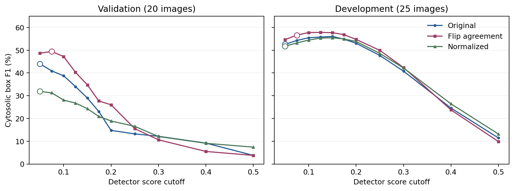
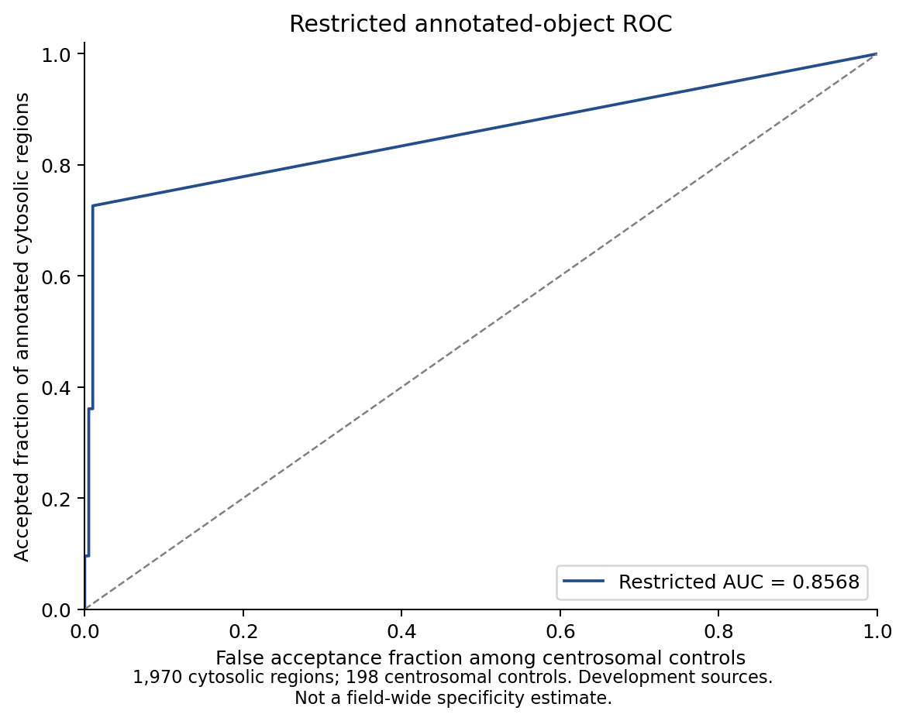
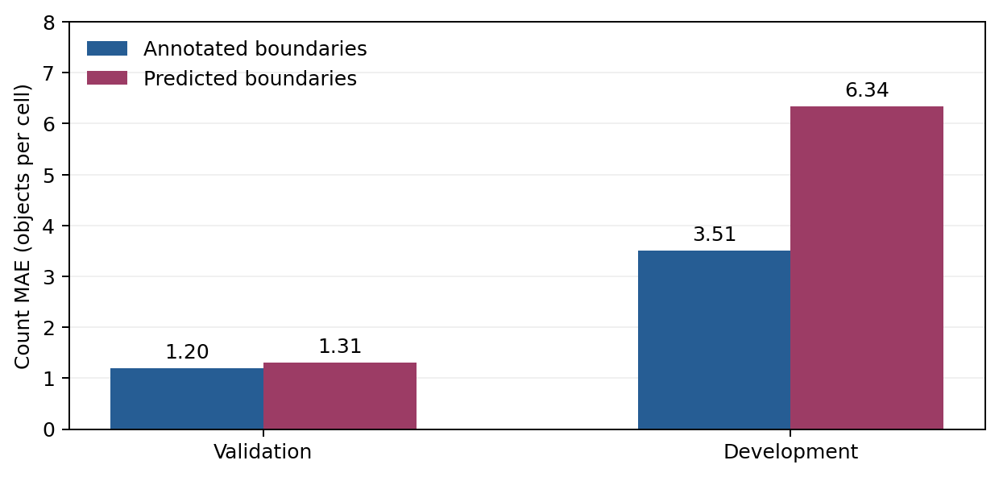
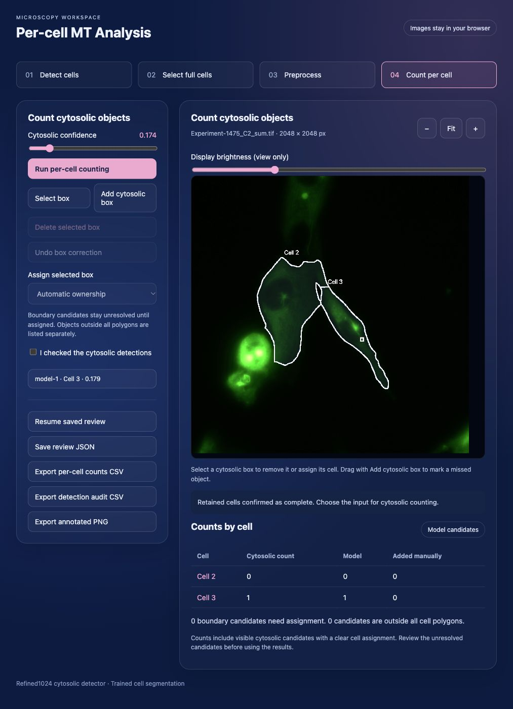
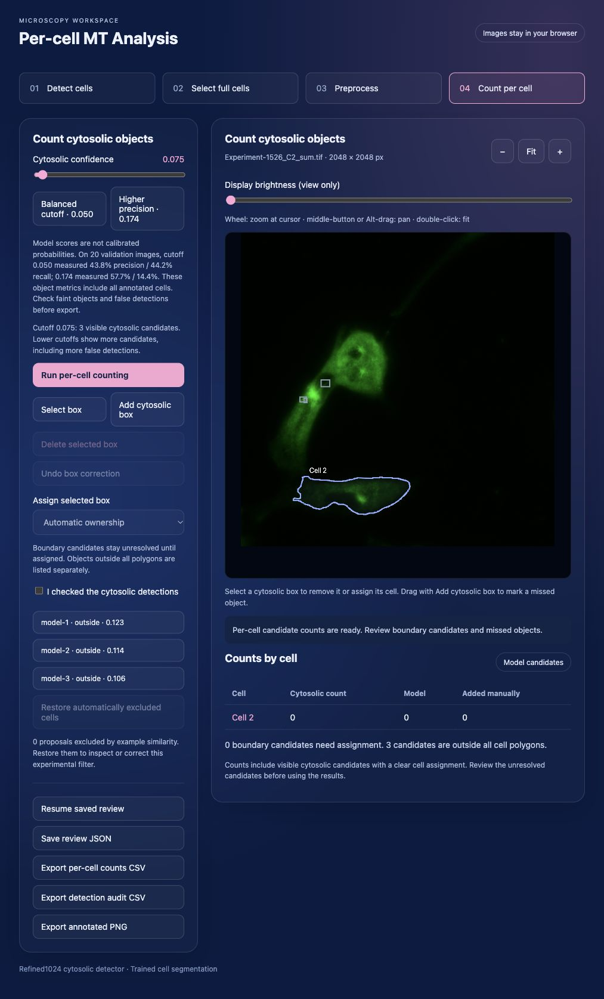

# Browser-based per-cell cytosolic microtubule analysis

Technical report for the Refined1024 release · 5 November 2026

## Abstract

The application combines a Refined YOLOv10n object detector with MobileNetV3-Small cell segmentation at 1024 × 1024 input resolution. It proposes cell outlines, assigns cytosolic detections to confirmed cells and exports candidate counts. On 20 validation images, flip agreement reached 49.4% cytosolic detection F1 at a cutoff of 0.075. On 25 development images, its F1 was 56.6%, compared with 54.9% for the original-image default at 0.174. The original default had lower image-level count error. Cell segmentation matched 106 of 166 annotated development cells at polygon IoU ≥ 0.5. Human review remains part of the counting workflow.

## 1. Scope and data

The detection target is the cytosolic object represented by an annotated bounding box. Per-cell counts combine the detector's outputs with reviewed cell boundaries. Measurements refer to annotated objects and do not estimate filament length or reconstruct a microtubule network.

The source dataset contains 105 green-palette, 8-bit TIFF images at 2048 × 2048 pixels. The original training pool contained 80 images. The recent benchmark uses 60 for fitting and reserves 20 for checkpoint and cutoff selection. It reports development performance on 25 previously examined images. Both the calibration and development sets have prior model exposure.

| Original data partition | Images | Cytosolic boxes | Centrosomal boxes | Cell annotations |
| --- | ---: | ---: | ---: | ---: |
| Training pool | 80 | 1,484 | 290 | 258 |
| Development | 25 | 1,970 | 198 | 166 |
| Total | 105 | 3,454 | 488 | 424 |

[Dataset audit](microtubule-studio/metrics/dataset_audit_summary.json) · [Ownership audit](microtubule-studio/metrics/ownership_audit_summary.json)

## 2. Methods and application features

| Stage | Method and user controls |
| --- | --- |
| Image input | Open TIFF, PNG or JPEG. Run both ONNX models in the browser. Coordinates map back to the original image for review and export. |
| Cell segmentation | Generate editable polygons. Use the foreground cutoff to adjust proposals. Add a missed complete cell, redraw boundaries or remove a partial or merged proposal. |
| Full-cell selection | Confirm that retained cells are complete. A complete cell may touch the image border or lack a detected centrosome. |
| Example exclusion | Optionally remove proposals close to reviewed rejected examples using shape and intensity. Restore excluded proposals from the sidebar. |
| Cytosolic detection | Use original intensity, percentile normalization or flip agreement. Adjust the score cutoff. The presets at 0.050 and 0.174 describe original-image operating points. |
| Assignment and corrections | Assign boxes by overlap and centre location. Review ambiguous or outside-cell detections. Add or remove boxes and override ownership when needed. |
| Preview | A square image panel shows outlines, candidate boxes and provisional per-cell counts. Wheel zoom follows the cursor. Middle-button or Alt-drag pans. Double-click fits the image. Brightness changes the display only. |
| Outputs | Export per-cell counts CSV, a detection audit CSV and an annotated PNG. Save or resume a JSON review using the same source image. |

### 2.1 Detection and segmentation

The detector uses Refined YOLOv10n with whole-image input at 1024 × 1024. Same-class overlap suppression removes lower-scoring boxes with IoU above 0.5. The cell model produces foreground, boundary and distance maps, from which the app builds polygon proposals.

Flip agreement runs the detector on the original image and its horizontal reflection. It maps flipped boxes back to the original coordinates and pairs overlapping detections at IoU ≥ 0.5. Matched coordinates and scores are averaged. Detections seen in just one view receive half their original score. The released mode uses cutoff 0.075 and adds an inference pass.

A box receives an automatic cell assignment when its centre lies in one polygon, at least 80% of the box lies inside that polygon, and the next largest overlap is at most 10%. Other boxes remain outside or unresolved until review. Counts and CSV export use the retained polygons after confirmation.

### 2.2 Evaluation protocol

One-to-one box matching uses IoU ≥ 0.5. Precision and recall compare predictions with existing annotations. F1 is their harmonic mean. The cutoff sweep selected a threshold on the 20 calibration images for each inference policy and applied it to the 25 development images. Image-level MAE measures absolute count error per image. Per-cell MAE uses the specified cell cohort and boundaries.

## 3. Results

### 3.1 Cytosolic detection and confidence

| Inference policy | Cutoff | Validation F1 | Development precision | Development recall | Development F1 | Development count MAE per image ↓ |
| --- | ---: | ---: | ---: | ---: | ---: | ---: |
| Original-image release default | 0.174 | 23.1% | 55.9% | 53.9% | 54.9% | 17.92 |
| Original, validation-selected | 0.050 | 44.0% | 41.3% | 72.2% | 52.6% | 58.80 |
| Percentile normalization | 0.050 | 31.9% | 40.2% | 72.5% | 51.7% | 63.20 |
| Original and flipped union | 0.075 | 46.4% | 40.3% | 75.4% | 52.5% | 68.48 |
| Flip agreement | 0.075 | 49.4% | 46.8% | 71.7% | 56.6% | 41.88 |
| Original and normalized union | 0.050 | 39.2% | 38.2% | 75.1% | 50.6% | 76.16 |

Flip agreement improved F1 over the original-image default in both sets. Its higher recall came with lower development precision and higher image-level count error. This trade-off is why the original-image mode at 0.174 remains the default and flip agreement is optional. The 0.075 cutoff was selected for F1. Per-cell count accuracy with flip agreement remains unevaluated.



*Figure 1. Cytosolic box F1 across tested cutoffs. Open markers show each policy's validation-selected cutoff, carried through to development.*

[Full inference comparison](microtubule-studio/metrics/flip_agreement_evaluation.json)

### 3.2 Historical detector and count benchmarks

The original-image detector at 0.174 matched 1,061 of 1,970 cytosolic annotations on development. Faint-object recall was 54.5% and AP50 was 0.4463. The restricted ROC-AUC was 0.8568 for 1,970 annotated cytosolic regions and 198 annotated centrosomal controls. That comparison uses a specific control population and cannot estimate background-wide specificity.

On 135 reference-resolved cells with supplied polygons, the earlier count protocol reported MAE 3.07, RMSE 5.32 and mean signed error −2.27 objects per cell. Nineteen cells had exact agreement, and 54 were within one object. The segmentation experiment below uses a different cohort and ownership protocol.



*Figure 2. Historical ROC curve for annotated cytosolic regions against annotated centrosomal controls.*

[Selected detector metrics](microtubule-studio/metrics/selected.json) · [Per-cell count summary](microtubule-studio/metrics/count_summary.json) · [Historical precision–recall figure](docs/figures/selected_precision_recall.png)

### 3.3 Cell segmentation and per-cell counts

| Metric at polygon IoU ≥ 0.5 | Validation | Development |
| --- | ---: | ---: |
| Images | 20 | 25 |
| Annotated cells | 55 | 166 |
| Predicted cells | 51 | 182 |
| Matched cells | 42 | 106 |
| Cell precision | 82.4% | 58.2% |
| Cell recall | 76.4% | 63.9% |
| Cell F1 | 79.2% | 60.9% |
| Mean IoU of matched cells | 0.689 | 0.683 |
| Foreground Dice | 0.845 | 0.812 |
| Count MAE with annotated boundaries | 1.20 | 3.51 |
| Count MAE with predicted boundaries | 1.31 | 6.34 |
| Count RMSE with predicted boundaries | 2.40 | 10.46 |

Replacing annotated boundaries with predicted polygons increased development MAE by 2.84 objects per cell under this protocol. It also left 76 predicted cells unmatched. Overlap with an annotation does not establish that a proposed outline is a complete, eligible cell. The similarity filter reproduced two reviewed exclusions on its reference image and excluded no proposals on 44 other images.



*Figure 3. Within-protocol comparison of per-cell count MAE for supplied and automatically predicted boundaries.*

[Segmentation evaluation](microtubule-studio/metrics/cell_segmentation_evaluation.json)

### 3.4 Benchmark-guided fine-tuning

The six-epoch experiment gave additional exposure to 12 training images ranked by missed annotated objects, with extra weight for low contrast. The best saved candidate came from the first completed epoch. At cutoff 0.050, validation F1 increased from 44.0% to 46.9%, while development F1 changed from 52.57% to 52.64%. At the release cutoff of 0.174, development F1 fell from 54.9% to 53.8%, faint recall fell from 54.5% to 53.4%, and per-cell MAE rose from 3.07 to 3.24. The released detector remains the better choice for that operating point.

[Fine-tuning comparison](microtubule-studio/metrics/benchmark_finetune_evaluation.json)

## 4. Browser snapshots and verification



*Figure 4. Full-cell review on Experiment 1475. The CSV contained the two retained cells, with candidate counts of 0 and 1 at cutoff 0.174. This snapshot predates the final square preview.*



*Figure 5. Flip agreement on Experiment 1526 after removal of a merged proposal. Three detections are outside the retained polygon. The retained cell has a candidate count of zero.*

The current browser workflow has been checked on multiple images. Recorded tests verified image loading, full-cell confirmation, exclusion from exported counts and flip-agreement inference. The deployment check validates both ONNX hashes, the detector's class mapping and cutoff, and required app assets. Shared review tests and archived reviewer tests cover coordinate mapping, manual edits and review import.

```bash
node microtubule-studio/scripts/check-deployment.cjs
node --test microtubule-studio/tests/review.test.cjs archive/image-level-reviewer/tests/app.test.cjs
```

## 5. Limitations

- Prior exposure to the calibration and development sources limits generalization claims. An independent evaluation would require additional image acquisitions.
- Supplied annotations may omit real objects. Reported precision, recall and count errors are relative to those annotations.
- Reduced image resolution can obscure small structures. The size-dependent effect needs a controlled crop comparison.
- Touching cells can merge, and the example exclusion rule has limited evidence beyond its reference image. Counts remain provisional until boundaries and detections are reviewed.
- Detection scores are ranking scores. Their numerical values do not represent calibrated probabilities.
- The repository includes deployment weights and recorded metrics. Full retraining requires the original TIFFs, labels and native checkpoints.

## 6. Improvement plan using the existing labels

| Experiment | Comparison and acceptance criteria |
| --- | --- |
| Overlapping crops at 1024 input | Compare native-scale crops with whole-image Refined1024 using the existing boxes. Merge overlapping detections in original coordinates. Check faint and small-object recall, duplicate boxes, per-cell MAE and inference time. |
| Calibrate for counting | Select a cutoff on calibration images using per-cell MAE with a precision or unmatched-box constraint. Evaluate the fixed policy on development with the same supplied polygons. Compare original and flip agreement under the same counting protocol. |
| Test consistency training | Use image transformations and existing labels to measure whether training on consistent views improves ranking. Keep a matched training control with the same checkpoint and epoch budget. |
| Improve touching-cell separation | Compare boundary-aware splitting settings against the existing polygons. Measure merge and split errors separately. Use centrosomes as supporting evidence for boundaries and retain full-cell confirmation before counting. |

## 7. Run locally

```bash
python3 -m http.server 8765 --bind 127.0.0.1 --directory microtubule-studio/dist
```

Open [the local app](http://127.0.0.1:8765/), load an image and choose **Detect cells + microtubules**. Confirm the retained complete cells, select a counting input and run per-cell counting. The browser loads the inference runtime and TIFF decoder from jsDelivr.

[Earlier technical report](TECHNICAL_PAPER.md) · [License](LICENSE) · [Third-party notices](THIRD_PARTY_NOTICES.md)
